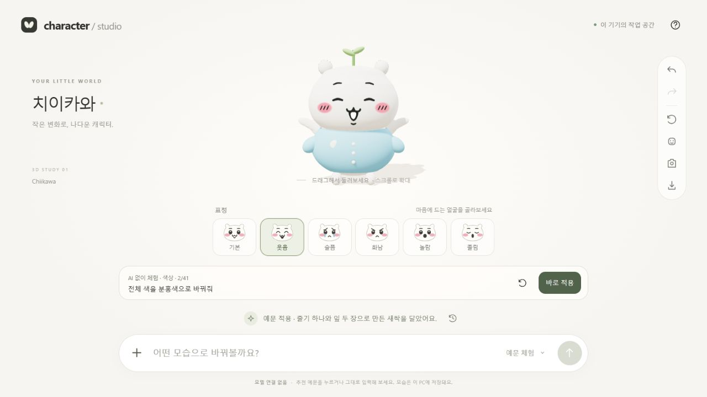

# Character Studio

내 캐릭터를 저장해 두고 표정·옷·장식을 바꾸며 여러 모습으로 꺼내 쓰는 웹 스튜디오입니다. 공개 저장소는 [Hanzi-Cho/character-studio](https://github.com/Hanzi-Cho/character-studio)입니다. 예전 작업명 Softform Studio는 로컬 폴더와 일부 내부 식별자에 남아 있습니다.

브라우저에서 치이카와·우사기 기본 모델을 고르거나 참고 이미지로 단순 3D 초안을 만들고, 하단 채팅으로 편집합니다. React + TypeScript + Three.js를 사용합니다. 웹에서는 **본인 OpenAI API 키**, 로컬에서는 **공식 ChatGPT 로그인 또는 기존 Codex CLI**로 AI를 연결합니다. 여러 편집 명령을 검증한 뒤 한 번에 저장하며 셔츠·날개·왕관 등 9개 장식 유형과 기본 도형을 조합한 새 장식을 지원합니다. 정밀 메시 복원이나 Blender 조형은 아직 지원하지 않습니다.

Codex 없이도 **41개 추천 예문**으로 색상·옷·장식·표정을 바꿀 수 있습니다. 예문마다 편집 명령을 JSON으로 저장해 두었으며 모델 호출 없이 같은 검증·저장·되돌리기 경로를 사용합니다. [예문과 실행 방식](docs/features/offline-command-examples.md) · [사전 직렬화 JSON](src/domain/command-examples.json).

## 설치 없이 웹에서 체험하기

**[Character Studio 웹 데모 열기 ↗](https://hanzi-cho.github.io/character-studio/)**

로그인·설치·API 키 없이 접속해 추천 문장의 **바로 적용**을 누르세요. 새로고침은 다른 문장을 무작위로 추천하며 번호는 표시하지 않습니다. PC·모바일 브라우저에서 회전, 표정·옷·장식 편집, 되돌리기, PNG/JSON 저장을 체험할 수 있습니다.

자유 채팅은 상단 **내 AI 연결**에서 본인 OpenAI API 키를 입력해 사용합니다. API 사용료는 본인 계정에 청구됩니다. AI를 연결하지 않으면 예문과 지원 규칙 명령만 처리합니다. 캐릭터와 최근 50개 변경은 **각 방문자의 브라우저**에 저장됩니다. AI 연결 시 자유 입력·현재 캐릭터·선택한 이미지가 OpenAI로 전송되며, 키는 탭 메모리에만 남습니다. 사이트 데이터 삭제 시 작업이 사라지므로 JSON으로 내보내 보관하세요. 최신 브라우저의 WebGL·localStorage·Web Locks가 필요하며, 모바일 실기기 검증은 아직 남아 있습니다.

`pnpm build:web`로 정적 파일을 `dist-web/`에 생성합니다. main 변경 시 GitHub Actions가 테스트 후 이 폴더만 Pages에 게시합니다. `.data`, 서버, 로그인 정보는 배포물에 포함하지 않습니다. [배포 구조](docs/features/github-pages-demo.md).



Meta Model API는 접근 승인 후 연결할 후속 경로입니다. 모델 학습·파인튜닝을 수행하지 않습니다. [실제 AI 구현과 녹화 순서](docs/features/codex-character-editing.md), [문서 교정에 설치한 Humanizer](docs/WRITING.md)를 참고하세요.

## 내려받아 체험하기 — Codex 불필요

Git과 Node.js 24 이상을 설치하세요. 다음 명령으로 프로젝트를 내려받고 실행합니다. 이 모드는 ChatGPT 계정·Codex·API 키가 필요 없습니다. 처음 패키지를 설치할 때는 인터넷이 필요합니다.

```sh
npm install -g pnpm@11.25.0
git clone https://github.com/Hanzi-Cho/character-studio.git
cd character-studio
pnpm install --frozen-lockfile
pnpm build
pnpm demo
```

[http://127.0.0.1:4317](http://127.0.0.1:4317)을 열고 **바로 적용**을 누르세요. 새로고침 아이콘은 다른 예문을 무작위로 보여주며 캐릭터는 바꾸지 않습니다. Windows에서는 설치·빌드 후 `Start-Demo.cmd`로 다시 열 수 있습니다.

이 모드도 **내 AI 연결 → Continue with ChatGPT** 또는 API 키로 자유 채팅을 활성화할 수 있습니다. ChatGPT 로그인은 로컬 실행에서 지원합니다. Windows 실기기에서 검증했으며 macOS/Linux의 전체 설치·화면 동작은 아직 검증하지 않았습니다.

## 자신의 Codex로 자유롭게 채팅하기

[공식 CLI 설치 안내](https://learn.chatgpt.com/docs/cli)를 따라 최신 Codex CLI를 설치하고, 본인 계정으로 로그인하세요. 기존 데모 서버를 터미널에서 `Ctrl+C`로 종료한 뒤 실행합니다.

```sh
codex login
codex login status
pnpm doctor
pnpm start
```

`pnpm doctor`는 Node, 빌드 파일, CLI 옵션과 ChatGPT 로그인을 확인합니다. 모델 호출은 하지 않습니다. Windows에서는 `Start-Studio.cmd`로도 시작할 수 있습니다. npm의 Windows 실행 래퍼와 독립 실행형 CLI를 지원합니다.

CLI 경로의 기본 모델은 `gpt-6.1-sol`이며 계정의 모델 접근 권한·잔여 한도가 적용됩니다. CLI는 ChatGPT 로그인만 사용하고 과금 API 키로 자동 전환하지 않습니다. 앱의 **내 AI 연결**에서 API 키를 명시적으로 연결하는 것은 별도 경로입니다. CLI 인증 파일은 각자의 Codex가 관리하며 프로젝트에 넣지 않습니다. [OpenAI 인증 안내](https://learn.chatgpt.com/docs/auth).

`하늘색 셔츠를 입히고 왕관 대신 새싹을 달아줘`처럼 목록에 없는 요청은 실제 AI로 해석합니다. 41개 예문과 정확히 같은 문장은 Codex 모드에서도 로컬로 처리합니다. AI 실패 시 오류를 보여주고 현재 모습을 보존합니다.

문제가 생기면 `pnpm doctor`를 먼저 실행하세요. CLI 경로를 찾지 못하면 `CHARACTER_CODEX_PATH`에 설치 경로를 지정합니다. 모델 접근 오류는 `CHARACTER_CODEX_MODEL`에 본인이 사용할 수 있는 모델을 지정한 뒤 재시작합니다. 포트 충돌은 기존 서버를 종료하거나 `SOFTFORM_PORT`를 변경하세요. PowerShell에서 스크립트 실행 정책 오류가 나면 `pnpm.cmd`, `codex.cmd`를 사용할 수 있습니다.

검증: `pnpm typecheck`, `pnpm test`. 소스 변경 후 `pnpm build`, 브라우저 새로고침. 서버 코드 변경은 서버 재시작이 필요합니다. 서버 중지 후 폴더의 `.data`를 보관하면 저장한 캐릭터와 이력을 유지할 수 있습니다.

## 사용법

- **내 캐릭터 보관함**: 현재 모습을 이름 붙여 저장하고 목록에서 불러와 계속 편집합니다. **변경 저장**은 선택한 보관본을 갱신하고 **새 캐릭터로 저장**은 이전 모습을 남깁니다. 최대 50개이며 삭제는 확인 후 실행합니다. 보관함은 로컬 실행에서도 현재 브라우저에 저장됩니다. 사이트 데이터 삭제 시 사라지므로 JSON으로 백업하세요. 자동 클라우드 동기화는 없습니다.
- JSON은 색·비율·표정·장식의 편집 설정입니다. 저장된 설정으로 3D를 다시 그리므로 큰 메시나 원본 이미지를 보관하지 않습니다. PNG는 공유용 이미지이며 3D 편집 상태를 복원하지 않습니다. [보관함 구조·용량 측정·복구](docs/features/character-library.md).
- 마우스로 드래그: 모든 방향 회전. 휠: 확대/축소. 장면에 키보드 초점을 두면 방향키 회전, Home 정면.
- 채팅 예: `하늘색 셔츠와 작은 하얀 날개를 달고 웃는 표정으로`, `머리 위에 줄기 하나와 잎 두 장으로 새싹 장식을 만들어줘`, `셔츠만 분홍색으로`.
- 얼굴 시안에서 **기본·웃음·슬픔·화남·놀람·졸림**을 선택하면 표정만 바뀝니다. `슬픈 표정으로`, `화난 표정으로`, `졸린 표정으로`도 지원합니다. 색상·체형·이름·장식은 유지되고 되돌릴 수 있습니다.
- [치이카와 57개 스티커 관찰 기록](docs/CHIIKAWA-REFERENCE-REVIEW.md) · [31장 추가 사진과 부위별 실측 수치](docs/CHIIKAWA-MEASUREMENTS.md) · [최신 모델링 변경과 확인 범위](docs/CHARACTER-MODELING.md)
- `되돌리기`, `다시 실행`, `초기화`. 최근 50개 변경을 저장합니다. 미지원 문장·부정문·상충 속성은 적용하지 않습니다.
- 카메라 버튼: PNG. 다운로드 버튼: 캐릭터 JSON. + 버튼: 저장한 JSON 또는 참고 이미지 1–4장 가져오기. 이미지 초안에는 AI 연결이 필요합니다.
- 도움말: 실제 지원 명령, 입력 한계, 로컬 저장 정책을 안내합니다.
- `http://127.0.0.1:4317/?benchmark=1`: 별도의 4,096개 반복 메시 실험. 전체 캐릭터 부하 실험과 구분합니다.

## 구성

```text
src/bootstrap.ts      gateway / renderer / model / ChatPanel 구현 조립
src/domain/           CharacterDocument v3, 기본 프로필·parts·EditPlan 스키마와 원자적 명령 컴파일
src/application/      편집 서비스 + 렌더러 / 해석기 / 저장소 / gateway 계약
src/presentation/     화면 상태·명령/복구, 렌더 수명과 교체용 UI 계약
src/adapters/         Three.js, 인스턴스 배치, 로컬 해석기, HTTP/SSE
src/components/       교체 가능한 ChatDock, Composer, 표정 시안, 도움말
src/dev/              반복 메시 배칭 검증 화면
server/               Codex 해석기 + 단일 저장소 + loopback HTTP + stdio MCP
tests/                도메인·영속화·경계·실제 MCP 통합·배치 회귀
docs/                 아키텍처, 원본 코드 연구, 범위/결정, 검증 근거
.data/                이 PC의 캐릭터·이력·이전 저장본 (Git 제외)
```

## 저장과 권한

서버는 **127.0.0.1**에만 바인딩합니다. 데이터는 `.data/character.json`에 저장되고 직전 저장본은 `.bak`입니다. 임시 파일 기록 후 교체하며, 손상된 파일을 기본값으로 조용히 덮어쓰지 않습니다. 복구는 서버를 멈춘 뒤 현재 파일을 따로 보관하고 검증된 `.bak`를 복사하는 수동 절차입니다. 전원 중단/디스크 장애 복구와 다중 서버 writer는 아직 검증하지 않았습니다.

하나의 로컬 사용자와 하나의 writer 서버를 전제로 합니다. Host/Origin 검사와 JSON 검증이 있지만 로그인/RBAC는 없습니다. 같은 PC의 프로세스·컴퓨터 소유자의 파일 접근을 차단하지 않습니다. **Codex 모드의 자유 입력과 현재 캐릭터 설정을 모델에 전송**합니다. 저장된 예문은 로컬에서 처리합니다. 앱의 채팅 내역은 현재 탭 메모리에 남고, 캐릭터와 최근 50개 변경 이력은 디스크에 남습니다. CLI는 ephemeral 모드로 실행하며 임시 입력/출력 파일을 요청 후 지웁니다. 공급자 측 보존 정책까지 앱이 통제하지는 않습니다. 인증 파일이나 API 키는 프로젝트에 복사하지 않습니다.

기본값은 `CHARACTER_CHAT_MODE=codex`, `CHARACTER_CODEX_MODEL=gpt-6.1-sol`입니다. CLI 경로는 `CHARACTER_CODEX_PATH`로 지정할 수 있습니다. `CHARACTER_CHAT_MODE=local` 또는 `pnpm demo`는 AI 연결 전까지 41개 예문과 기존 규칙 명령을 외부 AI 없이 처리합니다. AI 오류 시 예문 모드로 조용히 전환하지 않습니다. v1/v2 저장본과 변경 이력은 읽을 때 v3로 변환됩니다.

## MCP 개발 연결

앱을 실행한 상태에서 같은 PC의 stdio 지원 클라이언트가 `node --import tsx <절대경로>/server/mcp.ts`를 실행합니다. **클라이언트의 작업 디렉터리**를 이 프로젝트로 설정하거나, 아래처럼 tsx CLI도 절대경로로 실행합니다.

```json
{
  "command": "node",
  "args": [
    "C:/your/path/character-studio/node_modules/tsx/dist/cli.mjs",
    "C:/your/path/character-studio/server/mcp.ts"
  ]
}
```

이 PC의 Codex에는 `character-studio` stdio MCP를 등록했습니다. 다른 PC에서는 해당 환경에 맞춰 등록해야 합니다. 도구는 `get_character`, `update_character`, `edit_character`, `apply_edit_plan`, `get_model_capabilities`입니다. 변경 전 최신 revision을 읽고 충돌 시 재조회합니다. 호스트 모델은 `apply_edit_plan`으로 직접 직렬화해 추가 AI 호출 없이 적용할 수 있습니다. 브라우저는 SSE로 변경을 수신합니다. 현재 Codex 채팅의 도구 목록은 새 세션에서 갱신될 수 있습니다. 일반 사용자용 원클릭 연결·호스트 안의 3D 임베드·OAuth·모바일 브리지는 후속 작업입니다.

## 문서

- [기능 정의 문서 영역](docs/features/README.md)
- [초기 캐릭터 렌더 생성: 제작 과정·수치·수용 기준](docs/features/initial-character-render-generation.md)
- [v4 닮음 개선: 고정한 10점 기준과 반복 검증](docs/reviews/chiikawa-fidelity-improvement.md)
- [전체 파일 구조·결합도 점검·실제 리팩터링](docs/reviews/architecture-and-replaceability-review.md)
- [12종 기본 모델·채팅 부위 추가·초기화·저장 전략](docs/features/character-catalog-and-customization-strategy.md)
- [개선 전 v3 닮음 피드백](docs/reviews/chiikawa-render-fidelity-review.md)
- [채팅 구현 계획: ChatKit·AI 서비스·Configuration as Code](docs/features/character-chat-implementation-plan.md)
- [아키텍처 선택과 어댑터 경계](docs/ADR-001-ARCHITECTURE.md)
- [Human Atlas 소스 연구](docs/HUMAN-ATLAS-RESEARCH.md)
- [현재 구현·남은 결정](docs/MVP-STATUS.md)
- [요구별 테스트와 실제 검증 범위](docs/TESTING.md)
- [첨부 이미지에 따른 기본 모델 수정](docs/CHARACTER-MODELING.md)
- [출처와 재사용 구분](THIRD_PARTY_NOTICES.md)

치이카와·우사기는 사용자 지정 비공식 절차적 3D 스터디입니다. 공식 모델 파일을 사용하지 않았고 서비스 출시용 독자 캐릭터 생성기 완성을 의미하지 않습니다.


## 내 AI 연결 · API 키 / ChatGPT 로그인

공개 [웹 데모](https://hanzi-cho.github.io/character-studio/)의 **내 AI 연결 → 내 OpenAI API 키로 연결**에서 자신의 OpenAI API 키를 입력하고 전송·과금 안내에 동의한다. 계정에서 제공하는 모델을 선택한 뒤 채팅을 보낸다. 키는 현재 탭 메모리에만 두고 OpenAI 공식 API로 직접 전송한다. 새로고침/연결 해제 시 제거되며 localStorage, 캐릭터 JSON, 로그에 기록하지 않는다. API 사용료는 본인 계정에 부과되며 ChatGPT 구독과 별도다. 일반 Codex 로그인 토큰이나 auth.json을 복사하지 않는다.

**API 키 없이 ChatGPT 플랜을 사용하려면 로컬 실행** 후 내 AI 연결 → **Continue with ChatGPT**. 공식 계정 선택(연결된 Google 로그인 등)과 플랜 사용 동의 후 앱으로 돌아온다. 지원 플랜과 계정 정책에 따라 사용 가능 모델/한도가 다르다. 현재 OSS OAuth 규격은 `http://127.0.0.1:<port>/auth/callback`을 요구하므로 GitHub Pages 단독 로그인은 지원하지 않는다. 순수 Google OAuth만으로 AI 사용 권한을 얻는 구조가 아니다.

Codex CLI를 설치하지 않고 로컬 ChatGPT 로그인만 이용하려면 `pnpm install`, `pnpm build`, `pnpm demo`를 실행한다. Windows 실행기는 `powershell -ExecutionPolicy Bypass -File scripts/start.ps1 -Demo`를 사용한다. 이 모드도 실행 후 앱에서 AI를 연결할 수 있다. 이미 자신의 Codex CLI 로그인이 있다면 기존 `pnpm start` 흐름을 그대로 사용한다.

토큰은 로컬 서버 메모리에만 둔다. 서버 종료 후 재로그인이 필요하며, 재사용할 계정/앱 등록 메타데이터만 `.data/ai-registration.json`에 보관한다. 연결 해제는 원격 renewable session 철회를 시도하고 기기 토큰을 지운다. 원격 철회를 확인하지 못하면 화면 안내에 따라 [ChatGPT 사용량·앱 권한](https://chatgpt.com/settings/usage)에서 해제한다. `.data`는 Git에 포함하지 않는다.

Meta 모델은 아직 연결하지 않았다. 공식 API 접근 권한/호출 규격이 확보되면 `CommandInterpreter` 어댑터를 추가한다. 미확인 모델명·엔드포인트를 작동하는 선택지로 노출하지 않는다.

## 기본 모델과 참고 이미지

- 기본 모델 선택에서 치이카와/우사기를 즉시 로드한다. 변경 전 모습은 되돌릴 수 있다.
- `+`에서 참고 이미지 1–4장(PNG/JPEG/WebP, 원본 각 10MB 이하)을 선택하고 원하는 특징을 적어 보낸다. 같은 캐릭터의 여러 각도가 유용하다.
- 브라우저에서 긴 변 1024px 이하 JPEG로 재인코딩해 메타데이터를 제거한다. 선택한 이미지·요청·현재 캐릭터 설정이 연결한 AI에 전달된다.
- AI가 색, 머리 비율, 귀 크기·각도, 얼굴 유형·눈 크기를 `load_base` 명령으로 제안하고 검증 후 단순 3D 초안에 반영한다. 정밀 메시 복원이나 모델 학습 기능은 아니다.
- 원본 이미지·API 키·토큰은 캐릭터 JSON에 포함하지 않는다. 결과 설정은 저장·재불러오기·일반 채팅 수정이 가능하다. 초기화는 **현재 선택/생성한 기본 모델**로 돌아간다.
- 문서 스키마 v3. v1/v2 저장과 변경 이력은 치이카와 기본 프로필을 보완해 읽는다. 디스크 변경 시 `.bak`를 유지하며 브라우저 작업은 JSON 백업을 권장한다.

[기능 정의·검증 및 제품화 순서](docs/features/character-base-and-ai-connection.md)
