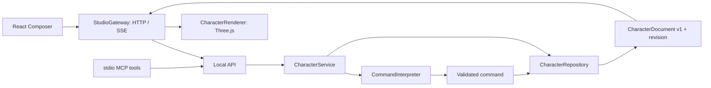

# ADR 001 — PC 우선 3D 편집기를 웹으로 시작

2026-10-24. 상태: 현재 PC MVP에 적용. 사용자 요청은 비개발자용 캐릭터 소통/편집, PC 실행 후 모바일 확장, Gemini·Claude·GPT/MCP 연결, Human Atlas 적극 분석이다. Compose보다 적합하면 대안을 사용하라는 실행 승인을 근거로 선택했다.

## 선택

React + TypeScript UI, 직접 Three.js 렌더러, 작은 Node HTTP 서버와 로컬 JSON 저장소를 쓴다. 모바일은 같은 웹 UI/렌더러를 먼저 검증한 뒤 PWA 또는 Capacitor 포장을 검토한다. 네이티브 모바일 앱, 원격 서버, 특정 AI 공급자를 이번에 도입하지 않았다.

이 요구의 중심은 웹 3D 조작과 채팅 UI이며 참고 프로젝트도 직접 Three.js를 사용한다. Three.js 리소스·입력·성능 도구를 바로 적용하고 PC/모바일 브라우저가 같은 코드 경로를 쓰는 쪽이 현 MVP에 유리하다. Android 전용 업무라면 선택이 달라질 수 있다.

## Compose Multiplatform과 비교

Compose는 Kotlin 도메인 코드·UI 공유와 기존 Android 팀의 숙련도를 활용하기 좋다. 웹은 Kotlin/Wasm과 Compose 기반 공유 UI, Kotlin/JS 상호운용 경로가 있다. 웹/3D를 못 한다고 배제한 것이 아니다. 그러나 이번에는 Three.js와 브라우저 입력·파일·MCP 표시 경계를 직접 다루므로 JS interop/호스트 view 경계를 추가하는 이점이 작다. 브라우저와 네이티브별 3D surface 선택·검증이 따로 필요해진다.

React Native + 별도 3D 런타임은 모바일 네이티브가 첫 목적일 때 비교할 수 있으나 현재 PC/웹 우선 요구와 Human Atlas 자산을 재사용하려면 플랫폼별 분기가 늘어난다. Electron/Tauri는 PC 설치·파일 시스템·업데이트가 필요할 때 포장 후보다. 첫 데모에서는 브라우저 + loopback 서버로 의존성과 유지비를 줄였다.

근거: [Kotlin 웹 개발 공식 안내](https://kotlinlang.org/docs/web-overview.html), [Three.js on-demand rendering](https://threejs.org/manual/pages/rendering-on-demand.html), [Capacitor 공식 문서](https://capacitorjs.com/docs). 플랫폼 선택은 이 요구에 대한 판단이며 공급자 공식 우열 주장이나 실측 벤치마크는 아니다.

## 흐름과 교체 지점

v4 구조 정리: 브라우저는 `bootstrap.ts`, 서버는 `server/main.ts`에서 구현을 조립한다. UI는 주입받은 ChatPanel/gateway/renderer factory만 사용한다. HTTP는 CharacterApplication을 받고, CharacterService가 interpreter/repository 및 커밋 이벤트를 소유한다. Three renderer도 모델 포트를 주입받는다. [전체 구조/실제 수정/파일 트리](reviews/architecture-and-replaceability-review.md)가 최신 상세 정본이다.

- **도메인**은 React/Three 타입을 모르며 JSON 문서·허용 속성·범위만 가진다. 좌표·mesh·material은 저장하지 않는다. geometry와 세계관 데이터를 바꾸려면 문서 schema 버전과 renderer mapper를 함께 설계한다.
- **CommandInterpreter**는 동기 또는 비동기 구현으로 교체 가능하다. 현재 엄격한 전체 문장 패턴을 쓰는 로컬 어댑터다. 향후 공급자가 만든 patch도 같은 schema/revision 검증을 거쳐야 한다. 임의 코드·파일 경로를 받아 실행하는 도구는 없다.
- **CharacterRepository**는 CharacterService 생성자에 주입된다. 현재 단일 writer 파일 저장소이며 향후 SQLite·기기 저장·서버 구현으로 교체할 수 있다. 동시 쓰기 충돌은 revision으로 드러낸다. 파일 저장을 다중 사용자용 DB라고 부르지 않는다.
- **CharacterRenderer**는 생성 후 유지된다. React 대화·이름·상태 갱신이 WebGL 재생성으로 이어지지 않는다. 색·transform·표정 group visibility만 변경하고 공용 sphere와 재질을 재사용한다. pointer/resize/control 변화가 있을 때만 RAF를 예약하며 damping 종료 후 예약을 멈춘다. DPR 2 상한, dispose, WebGL context-loss 안내, 키보드 회전과 reduced-motion 설정을 포함한다.
- **InstancedPartLayer**는 의미 없는 `RenderPart {id,position,scale,color}`를 받는다. 반복 geometry의 4,096개 인스턴스 실험에 사용했다. 수정한 instance의 buffer range만 표시하고 불변 값은 업로드하지 않는다. Human Atlas의 전체 O(N) 순회를 그대로 복사하지 않았다. spatial chunk/culling/가변 geometry/선택/삭제 API는 후속이다.
- **MCP**는 별도 writer가 되지 않고 HTTP 애플리케이션 서비스를 호출한다. UI와 같은 validation/undo/revision/SSE 경로다. Host UI 임베딩과 표준 MCP 도구 호출을 별개로 취급한다.

## Human Atlas에서 채택·보류한 것

채택: 장수명 scene, stable ID, geometry와 동적 상태 분리, batching 실험, 명확한 dispose, 입력/도구 계약 테스트. 원본의 chunk×system batching은 반복 도형에 더 적합한 InstancedMesh로 재해석했다.

보류: 해부학 schema/assets, shader 문자열 삽입, DataTexture 기반 exploded state, compressed mesh loader, DOM selector와 hardcoded inspector offset. 단일 절차 캐릭터에는 비용이 더 크다. 원본 `PointerTap`은 part 선택이 필요해질 때 MIT 고지와 함께 이식할 작은 후보지만 현재 회전만으로는 OrbitControls로 충분하여 복사하지 않았다. 근거와 후보 파일은 [상세 연구](HUMAN-ATLAS-RESEARCH.md)에 고정 SHA/라인 링크로 남겼다.

## 사용자 경험·권한·도움말·테스트

사용자는 화면에서 실제 사용감을 평가한다. 구현자는 드래그/키보드/복구/오류를 검증한다. 로컬 단일 사용자이며 별도 로그인이나 기기 간 권한 모델이 없다. 사진·음성·외부 모델 전송은 현재 비범위다. UI는 로컬 명령 지원 범위를 안내하며 테스트는 도메인·파일·HTTP·실제 stdio MCP·브라우저 관찰을 분리한다.

Jevons 관점: 자동 명령 편집이 요청을 늘려도 현재 외부 호출 비용은 없다. 향후 LLM 도입 시 무료 호스트 재사용 가능성과 지원 제약을 먼저 확인하고, 불명확한 요청을 무제한 재시도하지 않는다. 호출/토큰 상한과 취소·중복·복구는 도입 시 설계해야 한다.

## 후속 구현 순서

1. PC 사용감 피드백: 캐릭터 닮음·비율, 회전 감도, 채팅 문법/수정 피드백.
2. 우선 AI 호스트 하나에서 실제 tool 호출 + 화면 동기화 + 실패 안내 검증. 사용자가 연결 가능한 무료 경로를 확인한다.
3. 원클릭 연결 UX와 원격 여부·소유/전송/삭제·인증 결정. 로컬 stdio를 모바일 클라우드 호스트에 그대로 연결할 수 있다고 가정하지 않는다.
4. 모바일 실기기 touch/pinch/키보드/백그라운드 복귀, 성능·접근성 검증. 이후 PWA/Capacitor 선택.
5. 사용자 정의 모델/자유 형상 생성이 필요하면 GLB·rig·topology·작업 큐·provider schema를 추가한다. 현재 parameter edit와 구분한다.
