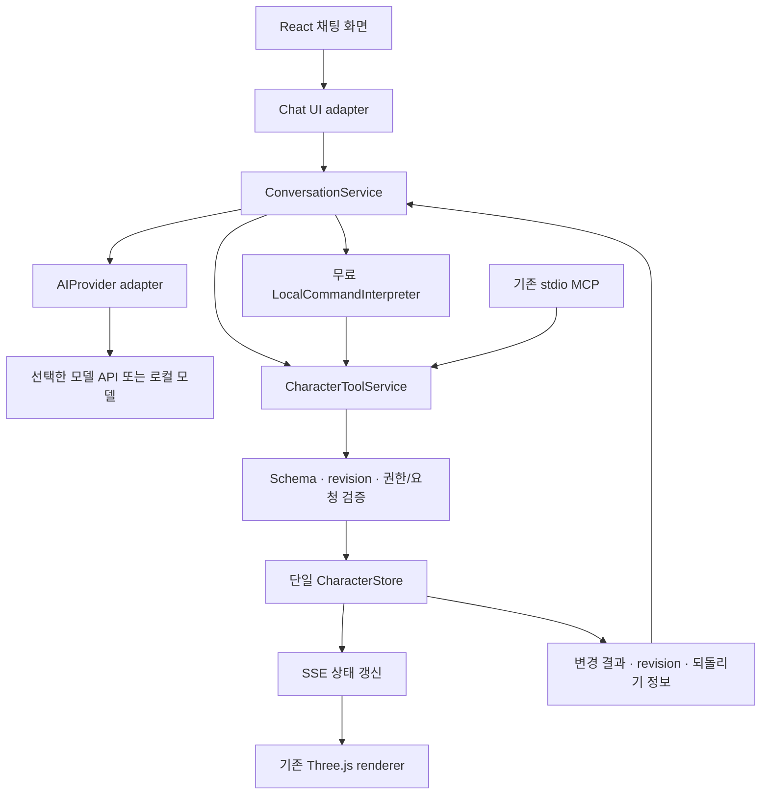

# Character Chat Implementation Plan

기능 ID: **F-002** · 작성일/공식 문서 확인일: **2026-10-24**  
상태: **제안·구현 계획**. ChatKit 패키지 설치, OpenAI API 호출, 계정·과금·클라우드 설정은 수행하지 않았다. 현재 앱은 제한된 로컬 명령 해석기다.

선행 검토: [현재 렌더 피드백](../reviews/chiikawa-render-fidelity-review.md), [F-001 초기 렌더 생성](initial-character-render-generation.md).

## 1. 권고

**ChatKit은 채팅 UI 후보로 적합하다. 서비스와 설정은 코드로 관리하고, 캐릭터 수정은 검증된 도메인 명령으로 연결하는 구성이 맞다.** ChatKit이 모델링 소스 파일을 자동 수정해주는 구조로 이해하면 안 된다. 실제 변경은 우리가 구현한 도구와 저장 계층이 담당한다.

우선 공통 채팅 서비스·도구 계약을 만들고, **ChatKit 자체 서버 방식으로 UI 적합성을 검증**하는 안을 권한다. 다만 기존 TypeScript/Node에 Python 런타임이 추가되는 비용이 있다. 지금과 같은 작은 하단 입력창을 유지하는 데 ChatKit의 제약이 크면 기존 React composer + 같은 채팅 서비스로 진행한다. UI 선택 때문에 렌더러나 저장소를 다시 만들지 않는다.

사용자의 무료 서비스 원칙을 적용해 기본 모드는 기존 로컬 편집으로 둔다. OpenAI를 통한 자유 대화/자연어 편집은 사용할 계정·모델·허용 비용·외부 전송 범위가 정해진 뒤 연결한다. UI SDK를 도입하는 것과 모델 사용료는 별개이며, 현재 API 비용 승인이 있다고 해석하지 않는다.

## 2. 공식 문서에서 확인한 사실

| 항목             | 확인한 내용                                                                            | 프로젝트에 주는 의미                                                                                 |
| ---------------- | -------------------------------------------------------------------------------------- | ---------------------------------------------------------------------------------------------------- |
| ChatKit          | 임베드 채팅 UI, 도구 호출 표시, 위젯, 첨부 지원                                        | 하단 대화 UI와 변경 결과 카드 후보                                                                   |
| 신규 연동 경로   | 자체 서버 연동 권장. Agent Builder는 2026-11-30 종료 예정이며 ChatKit 자체는 계속 제공 | 신규 hosted Agent Builder workflow를 만들지 않는 방향                                                |
| 자체 서버        | 공식 예시는 Python `openai-chatkit`, `ChatKitServer.respond`, HTTP/SSE, `Store` 계약   | Node 저장소 옆에 얇은 Python 브리지 제안. Node 전용 공식 대체 서버 SDK는 이번 조사에서 확인하지 않음 |
| 화면 설정        | theme·composer·header/history 등의 옵션 제공                                           | 현재 색·둥근 입력창·간결한 화면으로 맞출 수 있는지 실제 검증 필요                                    |
| 위젯 액션        | 사용자 액션을 서버로 보내거나 클라이언트에서 처리 가능. payload는 신뢰하지 않고 검증   | 적용/되돌리기 버튼도 같은 도메인 검증 경로 사용                                                      |
| Function calling | 모델이 구조화된 인수를 제안하고 앱이 도구를 실행. strict schema 지원                   | AI 출력만으로 성공 처리하지 않고 저장 결과로 확정                                                    |

근거: [ChatKit 안내/전환 일정](https://developers.openai.com/api/docs/guides/chatkit), [자체 서버 연동](https://developers.openai.com/api/docs/guides/custom-chatkit), [화면 설정](https://developers.openai.com/api/docs/guides/chatkit-themes), [Actions](https://developers.openai.com/api/docs/guides/chatkit-actions), [Function calling](https://developers.openai.com/api/docs/guides/function-calling). 이 표의 프로젝트 적용 판단은 공식 문서와 현재 코드를 결합한 제안이다. SDK/계정의 실제 사용 가능 여부와 호환성은 아직 실행 검증하지 않았다.

## 3. 현재 코드에서 재사용할 것

| 기존 코드                                                                   | 실제 역할                                                | 채팅 확장 시 처리                             |
| --------------------------------------------------------------------------- | -------------------------------------------------------- | --------------------------------------------- |
| [character.ts](../../src/domain/character.ts)                               | v1 문서·허용 범위·strict patch 검증                      | 도구와 설정의 공통 정본                       |
| [ports.ts](../../src/application/ports.ts)                                  | 해석기·저장소·렌더러·gateway 경계                        | 별도 Conversation/AI provider port 추가       |
| [LocalCommandInterpreter.ts](../../src/adapters/LocalCommandInterpreter.ts) | 정규식 기반 제한 명령                                    | 무료·오프라인 빠른 편집 유지                  |
| [store.ts](../../server/store.ts)                                           | 한 writer, revision, atomic 저장, undo/redo              | 모든 AI/MCP/UI 변경의 단일 실행 지점          |
| [http.ts](../../server/http.ts)                                             | loopback `/api/state`, `/api/patch`, `/api/command`, SSE | 채팅 스트림/동작 상태 조회 endpoint 추가 제안 |
| [mcp.ts](../../server/mcp.ts)                                               | 실제 stdio get/update/edit 도구                          | 같은 application service로 위임하도록 정리    |
| [HttpStudioGateway.ts](../../src/adapters/HttpStudioGateway.ts)             | 상태 읽기·변경·SSE 구독                                  | 모델 상태 동기화 유지                         |
| [App.tsx](../../src/App.tsx)                                                | 입력·최근 탭 메모리 대화·persistent renderer             | 채팅 presentation만 분리/교체                 |

현재 대화는 탭 메모리의 최근 20개이며 지속 대화 저장/AI 스트리밍이 아니다. 색·몸 비율·귀/눈 크기·표정·장식은 변경할 수 있지만 **머리 윤곽, 눈 반사광의 형태, 선 굵기, 새 부위 생성은 v1에서 편집할 수 없다.** 렌더 피드백의 부족한 점 모두를 ChatKit 연결만으로 고칠 수는 없다.

## 4. 제안 아키텍처



### A. ChatKit 자체 서버 UI · 우선 검증 후보

React `ChatKitChatPanel` → Node의 같은 origin `/chatkit` proxy → loopback Python `ChatKitServer` → Node `ConversationService`/도구 서비스로 연결하는 **브리지 설계**를 제안한다. Python은 ChatKit 이벤트·위젯·thread protocol을 맡고, AI 공급자 호출·도메인 명령의 권한은 Node에 모은다. SDK의 `respond`에서 임의 이벤트를 어떻게 중계할지는 작은 통합 실험으로 확인해야 하며 구현 완료된 구조가 아니다.

캐릭터 파일은 Node만 쓴다. Python이 `.data/character.json`을 직접 수정하지 않는다. 두 프로세스 사이에는 명시한 loopback 주소·세션 토큰·요청 크기 제한을 두고, 브라우저 요청에 기존 Origin 검사를 유지한다. 실행 스크립트는 준비 상태·종료·포트 충돌까지 처리한다. 공개 클라우드 서버 도입을 전제하지 않는다.

장점은 대화·도구 상태·결과 카드 UI 재사용이다. 대가는 Python 설치/패키징, 프로토콜 브리지, ChatKit 웹 자산 접근과 오프라인 동작 확인이다. ChatKit이 React 내부의 임의 DOM처럼 자유롭게 스타일링되거나 GPT 화면과 픽셀 단위로 동일하다고 보장하지 않는다.

### B. 기존 React composer + Node 채팅 API · 단순한 대안

현재 입력창을 유지하고 `ConversationService`의 이벤트를 메시지·상태·되돌리기 카드로 표시한다. 새 Python 런타임 없이 기존 스택을 활용하고 모바일 레이아웃을 직접 제어할 수 있다. 스트리밍, 취소, 대화 기록, 접근성 UI를 직접 구현해야 한다. A와 같은 도구/저장 계약을 사용하므로 이후 ChatKit로 옮길 수 있다.

**선택 기준:** ChatKit 실험에서 현재 하단 UX, 한국어 IME, 회전 유지, 취소/에러, 저장 결과 카드가 잘 동작하고 추가 런타임 배포를 수용하면 A를 채택한다. 그렇지 않으면 B를 선택한다. 이 선택은 아직 사용자의 확정 결정이 아니다.

## 5. Service / Configuration as Code의 구체적 의미

세 가지를 구분한다.

1. **서비스 코드:** 대화 orchestration, AI provider 교체, 도구 실행, 검증·충돌·취소·결과 기록. 테스트와 Git으로 관리한다.
2. **버전 관리할 설정:** 허용 기능/범위, preset, 프롬프트, 모델 정책, UI 옵션, schema 버전. JSON/TypeScript 등 선언적 데이터로 두고 CI에서 검증한다. 비밀키는 설정 파일/프론트 번들/Git에 넣지 않는다.
3. **사용자가 만드는 상태:** 캐릭터 JSON, revision, 이력, 선택적으로 대화 기록. 런타임 저장 데이터이며 사용자 채팅마다 소스 파일을 수정하거나 재빌드하지 않는다.

예를 들어 “연분홍으로 바꾸고 웃게 해줘”는 다음 **도메인 patch**로 변환할 수 있다.

```json
{
  "bodyColor": "#f4b5c5",
  "expression": "happy"
}
```

색의 구체적 hex는 해석 결과의 예시다. AI가 이 값을 제안하면 schema 검증 → 현재 revision 확인 → 1회 저장 → SSE → 화면 반영 순서로 처리한다. 정확한 색을 지정하지 않은 경우 적용한 색을 결과 카드에 보여주고 되돌릴 수 있게 한다.

“위 반사광을 더 크게, 아래 반사광을 초승달로”는 현재 지원하지 않는다. 후속 v2에서 `eye.highlightPreset`, `face.strokeScale`, `head.profilePreset`처럼 제한된 설정을 추가한 뒤 처리한다. 임의 Three.js/JavaScript, shell, 파일 경로를 모델 출력으로 실행하지 않는다. 새로운 geometry/기능을 만드는 개발 작업은 별도 코드 변경·테스트 과정이다.

### 제안 파일 구조 · 아래 파일은 아직 생성하지 않음

```text
src/application/chat/ports.ts                  # AIProvider, ConversationRepository
src/application/chat/events.ts                 # delta, proposal, applied, failed...
src/components/chat/ChatPanel.tsx               # UI adapter 선택
src/components/chat/NativeChatPanel.tsx         # 기존 UI 확장
src/components/chat/ChatKitChatPanel.tsx         # A 선택 시
src/domain/chat.ts                             # 메시지·동작 결과 계약
server/chat/conversation-service.ts             # 턴 실행·취소·도구 loop
server/chat/character-tools.ts                  # UI/MCP/AI 공통 application 명령
server/chat/providers/openai-responses.ts       # 선택적 공급자
server/chat/operation-repository.ts             # 요청 중복/결과 재조회
server/chat/conversation-repository.ts          # 저장을 선택한 경우
config/chat.policy.ts                          # 기능/상한/모드
config/character-presets/*.json                 # 검증된 preset
prompts/character-editor.md                     # 버전 관리할 지시문
services/chatkit/{server.py,pyproject.toml}       # A 선택 시 얇은 브리지
tests/chat/{service,provider,contracts}.test.ts
```

정책 초안: 기본 provider=`local-command`, AI 연결 기본 꺼짐, attachment/voice 꺼짐, 한 턴에 병렬 mutation 금지, 명시적 1회 편집은 1개의 원자적 patch, 도구 loop 최대 4회, 요청 시간 제한 30초. 이 수치는 **제안 초기값**이며 실제 지연/모델 요구를 측정한 뒤 조정한다. 모델 ID·금액 예산은 미정이다.

## 6. 한 번의 요청을 처리하는 규칙

1. UI는 사용자 문장과 요청 ID를 보낸다. 서버가 현재 문서·revision·지원 capability를 읽고 턴의 기준 상태를 고정한다. AI가 임의의 파일/사용자 ID나 revision을 만들어 권한을 얻지 못하게 한다.
2. 선택된 모드가 빠른 편집이면 로컬 해석기를 사용한다. AI 모드이면 필요한 문장·문서 필드·지원 schema만 provider에 보낸다. 무료 모드에서 실패했다고 유료 호출로 자동 전환하지 않는다.
3. 도구는 `get_character`, `patch_character`, `undo_character`, `redo_character` 정도로 좁힌다. 자유 대화는 mutation 없이 응답한다. reset은 영향이 보이는 별도 UI 흐름으로 둔다. 모델이 직접 파일을 쓰는 도구는 제공하지 않는다.
4. Responses function schema는 strict 모드에 맞춰 구성한다. 모든 필드를 required로 요구하는 규칙과 기존 partial patch의 차이를 adapter가 해결한다. 예: 각 허용 필드를 nullable로 전달받고 null을 제외해 `PatchSchema`로 재검증한다. 빈 patch·unknown key·범위 밖·NaN은 거부한다. [공식 schema 규칙](https://developers.openai.com/api/docs/guides/function-calling).
5. 명확한 허용 편집은 한 번에 적용한다. 모호한 요청만 짧게 구체화하거나 제안을 보여준다. 미지원 요구가 섞였으면 처리 범위를 먼저 설명하고 임의로 지원 부분만 적용했다고 성공을 꾸미지 않는다.
6. 적용 직전 턴 기준 revision과 현재 revision을 비교한다. UI/MCP가 먼저 수정했으면 충돌로 종료하거나 최신 상태로 새 제안을 만든다. 새 revision을 끼워 넣어 오래된 상대 명령을 조용히 재실행하지 않는다.
7. 요청/도구 call ID로 중복 실행을 막는다. 파일 저장과 결과 기록의 중간에 프로세스가 죽는 경우까지 고려해 작업 ID와 결과 revision을 일관되게 보관하도록 저장소 계약을 확장한다. 별도 로그에만 ID를 쓰면 정확히 한 번 적용을 보장할 수 없다.
8. 저장 성공 결과 `{operationId, revision, changedFields, canUndo}`를 받은 뒤 `applied` 이벤트를 보낸다. 모델 문장의 “적용했어요”가 아니라 서버 receipt가 성공의 근거다. 실제 렌더에 반영되었는지도 클라이언트 상태에서 확인한다.
9. 스트림이 끊기면 같은 operation ID로 결과를 조회한다. 저장 전 취소는 무변경, 저장 후 취소는 “변경은 적용됨”과 되돌리기를 표시한다. 답변 생성 실패가 이미 완료된 저장을 자동으로 롤백하지 않게 한다.

## 7. 화면과 상호작용

기존 3D 영역과 표정 버튼을 유지한다. 하단에는 입력창, 전송/중지, 모드 표시를 두고 대화 내역은 필요할 때 펼친다. 초기 예시는 “몸을 민트색으로, 웃는 표정으로”, “어떤 걸 바꿀 수 있어?”로 한다. 실제 지원하지 않는 사진/마이크 기능은 작동하는 것처럼 보이지 않게 한다.

상태: 대기 → 해석/응답 중 → 변경 검증 중 → 적용됨 또는 오류/충돌/취소. 사용자에게 보여줄 문구는 “모양을 바꾸고 있어요”, “변경했어요”, “다른 곳에서 먼저 수정됐어요”처럼 목적을 설명한다. schema/revision 같은 구현 용어는 진단 정보로 한정한다.

결과 카드는 변경 항목·이전/이후 값·되돌리기를 제공한다. 토큰마다 3D 장면을 재생성하지 않는다. 최종 검증된 문서만 기존 renderer에 반영한다. 모바일에서는 가상 키보드가 떠도 전송/중지와 현재 캐릭터를 볼 수 있게 하고, 채팅 드래그와 장면 회전을 분리한다.

한국어 IME 조합 중 Enter 오전송 방지, Enter 전송/Shift+Enter 줄바꿈, 초점 유지, 상태의 접근 가능한 안내, 네트워크 실패 시 원문 보존이 수용 기준이다. 새 UI 구성이 필요하면 기존 승인된 간결한 하단 입력창을 기준으로 비교 시안을 먼저 검토한다.

## 8. 데이터·권한·비용

- **현재 로컬 범위:** 한 사용자, loopback 서버. 기존 파일 소유·Host/Origin 제한을 유지한다. UI 숨김을 보안으로 간주하지 않는다.
- **AI 전송:** 사용자가 선택한 AI 모드에서 문장과 필요한 캐릭터 설정만 전송한다. 로컬 전체 파일·비밀키·기존 대화 전체를 자동 첨부하지 않는다. 공급자 보관 정책과 앱의 대화 저장은 별도다. 계정별 보관 정책은 도입 시 확인한다.
- **키:** 서버 환경 또는 OS 자격 증명 저장소. `.env.example`에는 변수명만 둔다. 브라우저 bundle, export JSON, error 로그에 키를 넣지 않는다.
- **기록:** 초기 제안은 대화 내용은 현재처럼 탭 세션 범위, 캐릭터와 작업 receipt만 로컬 지속 저장. 대화 재개를 원하면 저장 위치·삭제·보존 기간·백업을 함께 결정한다. 서버 측 임시 thread도 종료/만료 정리한다.
- **삭제:** 대화 삭제와 캐릭터 삭제를 구분한다. 되돌리기 이력/백업까지 포함하는 삭제 범위를 문서화하고 검증한다. 기존 데이터의 자동 삭제를 이번 계획으로 실행하지 않는다.
- **비용:** OpenAI 모델 사용량은 선택 모델·입출력 토큰 등에 따라 달라진다. [공식 API 가격표](https://developers.openai.com/api/docs/pricing)를 기준으로 모델 선택 시 예산을 산정한다. ChatGPT 구독만으로 이 앱 API 비용이 해결된다고 가정하지 않는다. 예산 0 기본값에서는 외부 유료 호출을 거부한다. 무료 크레딧도 계정별 가용량 확인 없이 있다고 가정하지 않는다.
- **무료 대안:** 현재 명령 편집은 그대로 동작한다. 자유 대화를 비용 없이 하려면 로컬 모델 adapter를 별도 검토할 수 있지만, PC 사양·설치 용량·한국어 도구 호출 품질은 미검증이다.

## 9. MCP·모바일 확장 경계

ChatKit은 **우리 서비스 안의 채팅 화면**이다. Gemini/Claude/GPT 안에서 우리 캐릭터를 조작하는 것은 **외부 호스트와 MCP를 연결하는 별도 기능**이다. 두 경로는 공통 `CharacterToolService`를 사용하게 한다.

현재 stdio MCP는 같은 PC의 클라이언트 프로세스가 실행하는 도구다. 클라우드 AI 서비스가 사용자 PC의 `127.0.0.1`이나 stdio에 직접 접속할 수 있다고 설계하지 않는다. 원격 연결에는 호스트별 지원 확인, 원격 transport, 소유권·인증·연결 해제·데이터 동기화가 추가로 필요하다. ChatKit 도입이 세 호스트와 모바일 플러그인 지원을 자동 완성하지 않는다.

PC와 모바일의 3D/UI는 현재 웹 구조를 우선 재사용한다. 같은 기기의 모바일 로컬 서버, PC와 모바일의 LAN 연결, 클라우드 동기화는 각각 다른 구조이므로 실제 모바일 접속 방식을 결정한 뒤 테스트한다. `0.0.0.0` 바인딩이나 공개 터널을 계획 없이 추가하지 않는다.

## 10. 구현 순서와 완료 기준

| 단계                   | 작업                                                                                            | 완료 기준/산출물                                                                                  |
| ---------------------- | ----------------------------------------------------------------------------------------------- | ------------------------------------------------------------------------------------------------- |
| 1. 공통 계약           | 기존 UI/MCP 명령을 공통 도구 서비스로 정리; capability·event·receipt 정의; 코드형 정책/프롬프트 | 기존 14개 회귀 유지, 무료 로컬 모드로 적용/되돌리기, 가짜 provider 결과를 실제 AI로 표시하지 않음 |
| 2. ChatKit 적합성 실험 | 별도 설정으로 React UI와 자체 서버 브리지 연결, 결정론적 응답/위젯으로 화면 검증                | PC 하단 UX·한국어 IME·중지·오류·3D 유지 확인; A/B 선택 근거 기록. API 품질 통과로 간주하지 않음   |
| 3. 선택 provider 연결  | 계정/비용/전송 범위 확정 후 Responses adapter, strict tools, bounded loop                       | 실제 API 문장→도구→저장→SSE→화면과 실패 시나리오 검증                                             |
| 4. 신뢰성              | 중복/충돌/취소·재접속·저장 실패·재시작 후 상태/receipt 복원                                     | 성공 안내와 디스크·UI 상태 일치, 중복 적용 없음, 원문/저장본 손실 없음                            |
| 5. 형상 설정 v2        | 피드백 우선순위에 따라 눈/입/윤곽 preset 추가, v1 migration                                     | 새 설정의 수치·표정 보존·내보내기/가져오기·구버전 복구 통과                                       |
| 6. 실제 사용 확장      | 실제 모바일·외부 AI 호스트 한 곳씩 연결, 도움말·권한/연결 해제 검증                             | 대상 환경마다 수용 근거 확보; 미지원 호스트는 명시                                                |

단계 1~2는 모델 API를 호출하지 않는 범위로 구현할 수 있다. 단계 3의 비용·외부 전송, 단계 6의 새 원격 접근/배포는 이번 계획 요청만으로 승인된 것으로 처리하지 않는다. 기간은 런타임/모델/범위 결정 전 임의로 확정하지 않는다.

## 11. 검증 시나리오

| ID  | 사전 조건/입력                            | 기대 결과                                                     | 검증 계층                                           |
| --- | ----------------------------------------- | ------------------------------------------------------------- | --------------------------------------------------- |
| C01 | 흰 기본 모델, “민트색으로 하고 웃게 해줘” | 한 patch, 1회 저장, 색+표정 변경, 다른 속성 유지              | service 단위 → 실제 provider → PC UI                |
| C02 | “몸 색은 바꾸지 말고 웃게 해줘”           | expression만 변경                                             | 한국어 평가 세트·도구 인수·저장 재조회              |
| C03 | “날개 만들고 볼은 빨갛게”                 | 미지원 범위 설명, 임의의 부분 성공/새 geometry 생성 주장 없음 | provider 평가·무변경 확인                           |
| C04 | AI 처리 중 MCP가 먼저 수정                | stale 변경 거부, 재조회/재제안                                | 실제 HTTP+stdio MCP 통합                            |
| C05 | 같은 요청 중복/스트림 단절 후 재시도      | 작업 ID로 결과 확인, 중복 저장/undo 항목 없음                 | 저장소·장애 주입                                    |
| C06 | 저장 전/후 중지 각각 실행                 | 전: 무변경, 후: 적용 결과+되돌리기 표시                       | service 상태 전이·UI                                |
| C07 | 401/429/timeout/금액 상한/키 없음         | 정확한 연결/제한 안내, 유료 재시도 폭주 없음, 원문 유지       | fake provider + 승인된 실제 API 오류 확인           |
| C08 | unknown key/범위 밖/위젯 payload 조작     | 서버 거부, 파일 무변경, 키/내부 오류 미노출                   | contract·HTTP 음성 테스트                           |
| C09 | 3회 편집→undo/redo→재시작                 | revision/문서/receipt 일치, 예전 요청 재적용 없음             | 실제 디스크·재시작 통합                             |
| C10 | 한국어 IME·키보드·390px·실제 휴대폰       | 중복 전송 없음, 중지/입력 초점 유지, 회전 충돌 없음           | UI/실기기. viewport만으로 실기기 통과 처리하지 않음 |
| C11 | 보관/삭제 옵션 선택                       | 문서·대화·이력·백업의 삭제 범위가 안내와 일치                 | 데이터 계층·재조회·복구                             |
| C12 | 외부 호스트 연결/해제·타인 ID 요청        | 실제 지원 환경만 성공, 권한 없는 접근 거부                    | 원격 확장 단계의 호스트별 검증                      |

모두 **앞으로 구현할 수용 기준**이다. 현재 통과한 14개 테스트나 ChatKit 문서 읽기를 위 시나리오의 통과 증거로 전용하지 않는다.

## 12. 남은 결정과 기본 제안

| 결정                            | 기본 제안                                                    | 필요한 시점              |
| ------------------------------- | ------------------------------------------------------------ | ------------------------ |
| ChatKit + Python 수용 여부      | 2단계 실험 후 결정, 공통 도메인부터 구현                     | ChatKit 정식 채택 전     |
| AI 비용/모델/계정               | 무료 로컬 편집 유지, 예산 0. 유료 모델은 비용 승인 후 선정   | 실제 provider 호출 전    |
| 대화 보관                       | 탭 세션 범위, 캐릭터+작업 결과만 지속 저장                   | 대화 재개 구현 전        |
| 모호한 캐릭터 수정              | 가능한 것만 설명하고 구체화, 지원 범위를 넘는 코드 실행 금지 | 서비스 규칙 확정 시      |
| 형상 v2 범위                    | 눈 반사광/입 선 preset → 윤곽 preset 순                      | 렌더 품질 개선 착수 시   |
| 캐릭터 대화 성격                | 우선 편집 도우미, 캐릭터 역할 대화/기억/음성은 후속          | 자유 대화 기능 확대 전   |
| 첫 외부 호스트·모바일 접속 방식 | PC 웹 완성 후 한 호스트/한 실제 기기부터                     | 원격/모바일 통합 착수 전 |

에이전트는 승인된 구현·회귀·근거 기록을 맡고, 사용자는 실제 사용감·닮음·새 비용/원격 접근 범위를 결정한다. UX·권한·도움말·테스트 4축의 실제 근거가 모이기 전 제품화/출시 완료를 주장하지 않는다. 이번 산출물은 구현 순서와 선택 근거를 구체화한 계획이다.
