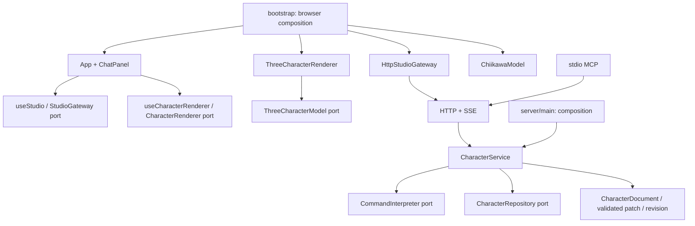

# Architecture and Replaceability Review

2026-10-24 · 대상: `softform-studio`, `codex/pc-3d-mvp`, 기준 `ac93896` 이후 작업 트리. 사용자 요청에 따른 전체 구조 검토와 수정 기록이다. 상위 Android GNSS 저장소는 대상이 아니다.

## 결론

기존 도메인/렌더러/저장소 포트는 출발점으로 적절했지만 **실제 조립과 명령 실행이 화면·HTTP에 남아 있었다.** UI를 바꿀 때 HTTP 구현을, 렌더러를 바꿀 때 치이카와 구현을 함께 수정해야 했다. 아래 결합을 이번에 끊었다. 현재 단일 캐릭터 편집 범위에서는 응집도와 교체 경계가 적절하며, 복잡한 기능을 추가할 기반이 마련됐다.

다만 `CharacterDocument v1`은 6표정·단일 장식·한 모델에 맞춰진 계약이다. 포트가 있다는 이유로 12종과 임의 날개를 이미 지원한다고 보지 않는다. v2 카탈로그/부위/표정 스키마와 마이그레이션을 먼저 구현해야 한다.

## 발견 → 실제 수정

| 문제 | 영향 | 이번 수정 |
| --- | --- | --- |
| App이 HTTP gateway와 Three renderer를 직접 생성 | UI/네트워크/그래픽 교체가 App 수정으로 번짐 | `bootstrap.ts`만 실제 구현을 선택하고 `StudioRuntime` 주입 |
| App 한 곳에 구독·명령·파일 import·렌더 수명·채팅 내역·도움말 | 기능 변경 시 서로 간섭, 오류 복구 중복 | `useStudio`, `useCharacterRenderer`, `ChatDock`, `HelpDialog`로 책임 분리 |
| JSON import가 공통 gateway를 우회해 request 호출 | 다른 저장/통신 방식에서 import만 실패 | 모든 편집을 `StudioGateway.patch`로 통일. 파일 읽기 전 revision 고정 |
| undo/redo 버튼이 자연어 해석기에 의존 | AI 장애/공급자 변경 시 기본 복구까지 실패 | typed `action` 포트 및 `/api/action`, interpreter 없이 undo/redo/reset |
| HTTP가 기본 interpreter 생성과 변경 알림까지 담당 | 새 AI tool 경로에서 변경은 저장돼도 화면 구독을 놓칠 수 있음 | `CharacterService`가 interpreter/repository 주입, revision·커밋 이벤트 소유. HTTP는 전송 경계 |
| renderer가 ChiikawaModel 직접 생성 | 다른 모델로 바꾸려면 카메라/조명 코드 수정 | Three 전용 `ThreeCharacterModel` 주입. 카메라·입력·RAF는 renderer에 유지 |
| HTTP/SSE 응답을 타입 단언만 함 | 잘못된 데이터가 UI·렌더러로 전파 | `SnapshotSchema` 런타임 검증, SSE 잘못된 응답은 연결 이상 표시 |
| 채팅 입력을 응답 전에 비움 | 미지원/충돌/네트워크 실패 시 입력 유실 | 성공한 문장만 비움. 요청 중 새로 쓴 문장은 유지 |
| 눈 크기 변경에 단순 3D group scale | 곡면과 다른 곡률로 확대되어 눈이 뜸 | 기존 vertex buffer를 곡면에 재투영. 실제 머리 triangle raycast 검증 |

## 의존성 방향



브라우저에서 편집한 상태와 MCP로 편집한 상태는 같은 서버 서비스와 저장소를 통과한다. **저장된 변경만** 서비스 이벤트로 전달되고 SSE가 화면을 최신화한다. 비동기 interpreter 실행 전후 revision이 달라지면 재해석 없이 덮어쓰지 않고 충돌로 돌려준다. 알림 수신자의 오류가 이미 성공한 저장을 실패로 바꾸지 않는다.

## 교체 방법과 계약의 한계

| 교체 대상 | 구현할 계약 / 조립 위치 | 유지되는 영역 |
| --- | --- | --- |
| 채팅 화면 | `ChatPanelProps`, `bootstrap.ts`의 ChatPanel | 데이터·undo·3D·저장 |
| 채팅 의미 해석 / LLM | `CommandInterpreter`, `server/main.ts` | HTTP·MCP·검증·저장·UI |
| UI가 통신하는 방식 | `StudioGateway`, `bootstrap.ts` | 화면·모델·3D 입력 |
| WebGL 엔진 전체 | `CharacterRenderer`, browser factory | 도메인·채팅·저장 |
| Three.js 안의 캐릭터 | `ThreeCharacterModel`, browser factory | 카메라·빛·회전·RAF·UI |
| 영속 저장 방식 | `CharacterRepository`, `server/main.ts` | 서비스·HTTP·채팅·렌더 |

이는 시작 시 조립 경계다. 실행 중 임의 플러그인 코드를 내려받는 hot plugin 시스템을 구현한 것은 아니다. 새 모델은 현재 문서 계약을 해석할 수 있어야 하며, 다른 필드를 필요로 하면 먼저 버전 있는 도메인 계약을 확장한다. ChatKit은 React 패널 하나만 갈아끼워 AI가 연결되는 것이 아니다. 세션/backend·tool 계약·인증/비용 범위를 [채팅 계획](../features/character-chat-implementation-plan.md)에 따라 별도로 구현해야 한다.

## 전체 파일 구조

생성물과 다수의 이미지 파일은 디렉터리 단위로 묶었다. 핵심 소스 파일은 전부 표시했다.

```text
softform-studio/
├─ src/
│  ├─ main.tsx                     앱 진입, 개발 benchmark 분기
│  ├─ bootstrap.ts                 브라우저 구현 조립: gateway / renderer / model / chat
│  ├─ App.tsx                      화면 배치·도구·export 연결
│  ├─ styles.css                   현재 단일 스튜디오의 공통 스타일/반응형
│  ├─ env.d.ts
│  ├─ domain/
│  │  ├─ character.ts              v1 문서·표정 enum·patch/snapshot schema·Command
│  │  └─ errors.ts                 전송 방식과 무관한 revision 충돌
│  ├─ application/
│  │  ├─ ports.ts                  interpreter / repository / renderer / gateway / service 계약
│  │  └─ CharacterService.ts       편집·typed action·revision·저장 후 이벤트
│  ├─ presentation/
│  │  ├─ ports.ts                  React ChatPanel props와 DOM renderer factory
│  │  ├─ useStudio.ts              snapshot 구독·명령·busy·오류 복구·import·대화 상태
│  │  └─ useCharacterRenderer.ts   렌더러 생성·update·dispose·오류 수명
│  ├─ components/
│  │  ├─ ChatDock.tsx              교체 가능한 하단 채팅/표정 패널
│  │  ├─ Composer.tsx              입력·IME·성공 후 clear·파일 선택
│  │  ├─ ExpressionPicker.tsx      6종 SVG 시안/선택
│  │  ├─ HelpDialog.tsx            실제 지원 범위 도움말
│  │  └─ Icon.tsx                  공통 아이콘
│  ├─ adapters/
│  │  ├─ HttpStudioGateway.ts      HTTP 요청·응답 검증·SSE
│  │  ├─ LocalCommandInterpreter.ts 로컬 한국어/영어 명령 해석
│  │  ├─ ThreeCharacterRenderer.ts  카메라·조명·OrbitControls·on-demand RAF
│  │  ├─ ThreeCharacterModel.ts     Three 모델의 root/update/resources/dispose 계약
│  │  ├─ ChiikawaModel.ts           치이카와 조형·표정·장식·문서 반영
│  │  ├─ chiikawaRig.ts             수치 정본·얼굴 좌표·머리 profile
│  │  ├─ faceGeometry.ts            곡면 패치·둥근 선·볼 falloff 재사용 도구
│  │  └─ InstancedPartLayer.ts      stable ID 기반 반복 도형·부분 업로드
│  └─ dev/BatchBenchmark.tsx        4,096 instance 실험 화면
├─ server/
│  ├─ main.ts                     서버 구현 조립·loopback 실행
│  ├─ http.ts                     Host/Origin·요청 schema·HTTP/SSE/static 전송
│  ├─ store.ts                    JSON 원자 교체·백업·50회 이력·revision
│  └─ mcp.ts                      실제 stdio 도구 → 같은 HTTP 서비스
├─ tests/
│  ├─ application.test.ts         교체한 비동기 interpreter·경합·typed action·이벤트
│  ├─ architecture.test.ts        계층의 금지된 static import 회귀
│  ├─ domain.test.ts              명령·범위·거부·파일 저장/손상/undo
│  ├─ integration.test.ts         실제 HTTP/stdio MCP·SSE·충돌·저장·Origin
│  ├─ model.test.ts               실제 메시·9개 윤곽 단면·눈 곡면·6표정/자원
│  └─ batch.test.ts               4,096 instance·부분 수정·원자적 범위
├─ scripts/build.mjs              esbuild + 배포용 static 파일
├─ scripts/start.ps1              설치된 Node 탐색·로컬 서버 실행
├─ Start-Studio.cmd               PC 실행 진입
├─ index.html
├─ package.json / pnpm-lock.yaml / pnpm-workspace.yaml / tsconfig.json
├─ README.md / THIRD_PARTY_NOTICES.md / .gitignore
├─ docs/
│  ├─ ADR-001-ARCHITECTURE.md      웹/Three 선택과 전체 원칙
│  ├─ HUMAN-ATLAS-RESEARCH.md      고정 SHA 소스 분석·채택/보류 근거
│  ├─ MVP-STATUS.md / TESTING.md   범위·남은 결정·검증 이력
│  ├─ CHARACTER-MODELING.md        모델 개선 이력
│  ├─ CHIIKAWA-MEASUREMENTS.md      v3 표본 측정 이력과 최신 정본 링크
│  ├─ CHIIKAWA-REFERENCE-REVIEW.md  57개 그림 선별 기록
│  ├─ features/
│  │  ├─ README.md
│  │  ├─ initial-character-render-generation.md
│  │  ├─ character-chat-implementation-plan.md
│  │  └─ character-catalog-and-customization-strategy.md
│  ├─ reviews/
│  │  ├─ chiikawa-render-fidelity-review.md  개선 전 v3 피드백
│  │  ├─ chiikawa-fidelity-improvement.md   10점 기준·반복 개선·최종 판정
│  │  └─ architecture-and-replaceability-review.md  이 문서
│  ├─ reference-data/             출처 CSV·12개 랜드마크·v4 윤곽 측정
│  └─ evidence/                   당시 화면·실제 메시 측정/스크립트
├─ .data/                        사용자 문서·백업·격리 QA·로컬 참고 자료, Git 제외
├─ dist/                         생성된 실행 번들, Git 제외
└─ node_modules/                 설치 의존성, Git 제외
```

## 유지한 응집도와 과한 추상화를 피한 부분

`ChiikawaModel`은 여전히 비교적 크지만 한 캐릭터의 조형과 표현을 소유한다. 렌더 엔진·HTTP·React는 모른다. 범용 수학/geometry 도구와 수치 정본을 이미 밖으로 분리했으므로, 표정마다 클래스/DI 컨테이너를 추가하지 않았다. 12종이 실제로 들어올 때 모델 패밀리별 생성기와 공통 expression recipe를 분리하는 것이 적절하다.

`ChatDock`은 ExpressionPicker를 포함하는 현재 패널이다. 전체 패널은 교체 가능하고, 입력창만 바꿀 때는 Composer만 바꾸면 된다. React view 상태는 presentation에, 캐릭터 문서는 domain에 둔다. 메시지 문장을 영속 캐릭터 모델에 섞지 않는다. CSS는 단일 화면 내 공통 스타일이며 아직 디자인 시스템 패키지는 아니다.

## 남은 설계·우선순위

1. **다음 구현 선행:** `CharacterTemplate/Instance v2`, templateVersion, part/expression ID, 마이그레이션·선택별 reset 계약. [12종 전략](../features/character-catalog-and-customization-strategy.md)의 순서로 진행.
2. **새 표현 기능 전:** SVG 시안과 3D는 지금도 별도 그림이다. 단일 expression recipe에서 두 어댑터가 읽도록 바꿔 커스텀 표정의 의미/미리보기 불일치를 방지한다. 현 6개는 의미 구분용 시안이며 정밀 3D 축소본이 아니다.
3. **새 날개/부위 전:** semantic socket + bounded recipe + instance별 stable ID + asset 수명/취소/undo. 모델별 root에 직접 hardcode를 계속 늘리지 않는다.
4. **실제 AI 전:** 제공자 어댑터·취소·시간제한·idempotency·응답 검증. 도구는 `CharacterService`를 호출하고 Three 객체를 반환하거나 임의 코드를 실행하지 않는다.
5. **제품화 전:** JSON 단일 writer의 한계, 백업 복구/삭제 UX, 데이터 마이그레이션, 실제 호스트·모바일·접근성·장애 회귀. 이 작업은 로그인/클라우드/유료 서비스를 도입하지 않는다.

## 검증 근거와 저장소 상태

자동 검증은 [TESTING.md](../TESTING.md)의 v4 기록을 따른다. 구조 테스트는 소스의 static import 규칙 검사이며 런타임 보안 격리 증명이 아니다. 실제 비동기 interpreter 대체와 HTTP 외 service 편집→SSE 전달까지 테스트한다. 실제 ChatKit/Gemini/Claude/GPT 연결 검증과 구분한다.

로컬 Git 브랜치는 `codex/pc-3d-mvp`, 시작 HEAD는 `ac93896`. `git remote -v`는 비어 있다. 이번 수정은 로컬 작업 트리에 있으며 GitHub에 반영됐다고 주장하지 않는다. GitHub 저장소 생성·공개 배포·Linear 단계 변경은 이 코드 검토의 결과로 수행하지 않았다.
