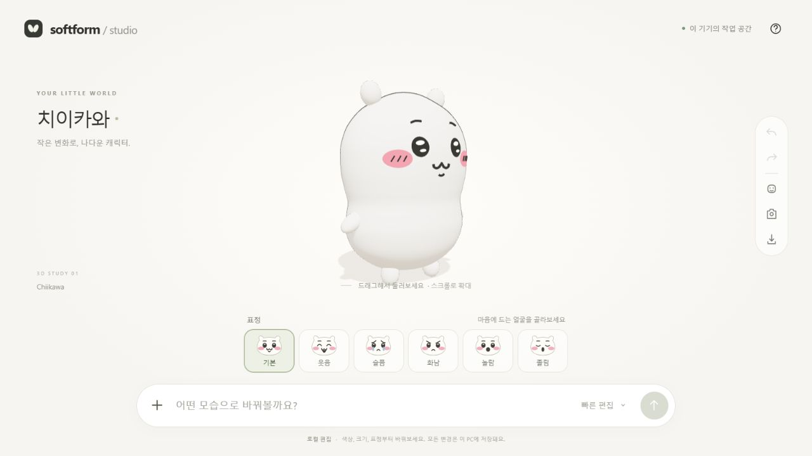
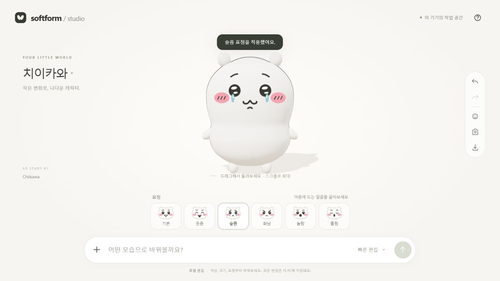

# Chiikawa Render Fidelity Review

> 이 문서는 개선 전 v3 평가이다. 현재 v4의 수치/형상 정본은 [초기 캐릭터 렌더 생성](../features/initial-character-render-generation.md), 개선 결과는 [v4 개선 기록](../reviews/chiikawa-fidelity-improvement.md)을 따른다.

2026-10-24 · 대상 코드 `ac93896` · 범위: 캐릭터의 닮음과 표정. 일반 UI 전체나 접근성 전체에 대한 감사는 아니다.

## 판정

**치이카와로 알아볼 특징은 갖췄지만, 원본과 가까운 완성도에는 아직 못 미친다.** 주관적 시각 인상으로 약 **6/10**이다. 이는 자동 유사도·실측 일치율·사용자 평가 점수가 아니다. 핵심 부족은 머리의 전체 크기보다 **볼/턱의 윤곽, 눈 반사광, 입과 눈썹의 선, 감정별 디테일**이다.

흰 둥근 귀, 검은 눈과 두 반사광, 분홍 볼, W 입, 짧은 팔다리가 인지에 기여한다. 전역 세로 압축을 제거하면서 납작한 머리는 개선되었다. 머리 H/W 실제 측정 .7583은 참고 사진 범위 안에 있고, 몸통보다 머리가 조금 넓어야 한다는 사용자 선호도 지켰다. **이 두 비율을 맞췄다는 사실만으로 전체 실루엣이나 얼굴 인상이 맞았다고 볼 수 없다.**

## 평가 조건과 근거

- 이번 검토에서 별도 4318 서버·`.data/feature-audit` 저장소를 사용했다. 기본 색 `#fffdf7`, 크기 배율 1, 장식 없음, Windows Codex in-app Chromium, 1280×720의 실제 WebGL 화면이다.
- 4317 사용자 작업 공간의 분홍색 캐릭터는 평가용 초기화 없이 보존했다. 사용자가 선택한 분홍색은 원본과 다르다는 이유로 결함에 포함하지 않았다.
- 아래 화면은 이번 검토에서 새로 저장했다. 최초 웃음 캡처 한 장은 선택 버튼과 렌더 갱신 시점이 달라 이전 얼굴이 잡혀 제외하고 실제 웃는 얼굴로 다시 캡처했다.
- 공식 [Kitan 얼굴 스퀴즈](https://kitan.jp/products/okaonosqueeze_chiikawa/)의 기본/웃음/울음/의욕 사진, 공식 [통통 봉제 인형](https://chiikawamarket.jp/products/4571609387930), [일반 봉제 인형](https://chiikawamarket.jp/products/4589468435181)을 대조했다. 참고 자료의 스타일·재질·상품 비율은 서로 다르다.
- 모델은 공식 3D 파일을 사용한 것이 아니라 관찰을 바탕으로 만든 절차적 스터디다. [수치와 제작 과정](../features/initial-character-render-generation.md), [원시 측정 기록](../CHIIKAWA-MEASUREMENTS.md)을 함께 본다.

## 1. 정면: 비율은 개선, 윤곽은 보완 필요

[전체 작업 화면](../evidence/initial-render-review/01-default-front.jpg) · [Kitan 기본 얼굴](https://kitan.jp/wp-content/uploads/2024/12/normal.jpg) · [통통 인형 정면](https://chiikawamarket.jp/cdn/shop/files/4571609387930_1.jpg)

**좋아진 점:** 눈·볼의 좌우 간격이 안정적이고, 머리 높이가 충분해졌다. 얼굴과 몸통 폭이 비슷한 현재 방향은 사용자가 요구한 모습과 부합한다.

**부족한 점:** 현재는 정수리가 둥근 돔이고 아래 얼굴 양옆이 길게 이어져 전체가 세로로 긴 콩/캡슐처럼 느껴진다. 참고 자료는 더 넓은 이마, 아래쪽 볼의 부피, 턱에서 몸통으로 넘어가는 경계가 인상을 만든다. 폭 2.32와 높이 1.76은 그 사이의 곡선을 설명하지 못한다. 몸통을 다시 과하게 좁히기보다, 현재 폭 제약 안에서 볼과 턱의 곡선을 다듬어야 한다.

귀도 작은 타원 덩어리를 꽂은 느낌이 남는다. 실제 참고 귀는 뿌리가 넓고 머리와 연결되는 곡선이 자연스럽다. 중심과 18° 기울기를 유지하더라도 귀 뿌리의 폭·겹침·끝의 둥글기를 별도로 조정할 필요가 있다.

**다음 측정:** 머리 v=.10/.25/.50/.75/.90에서의 폭, 볼 최대 폭의 높이, 턱 하단 곡률, 귀 뿌리 양끝과 돌출 높이. 한 기준 이미지의 좌표를 추적하고 사면과 동시에 확인한다. 현재 이 항목들의 정량 오차는 측정하지 않았다.

## 2. 사면: 얼굴 부착은 확인, 입체 형태의 기준은 부족

**좋아진 점:** 회전 시 눈·볼·입이 얼굴 곡면에 붙어 있고 실제 입체로 보인다. 정면 이미지를 단순 평면으로 보여주는 방식은 아니다.

**부족한 점:** 머리와 몸의 깊이를 단순한 회전체와 Z 배율 .70으로 처리해 이마·뺨·뒤통수의 깊이 변화가 단순하다. 입 주변과 볼륨의 관계도 약하다. 귀의 결합부와 옆으로 보이는 얼굴 요소의 두께는 정면보다 쉽게 드러난다.

**다음 검증:** 동일 상품군의 정면/측면/뒤를 기준으로 깊이와 귀 접합을 측정한다. 화면 한 장만 보고 전체 360° 닮음이 통과했다고 판정하지 않는다. 이번 사면 관찰은 구조/부착 확인이며 측면 정량 일치율은 아니다.

## 3. 표정: 감정 구분은 가능, 원작 특유의 선이 부족

[웃음 전체 화면](../evidence/initial-render-review/03-happy.jpg) · [공식 웃음 참고](https://kitan.jp/wp-content/uploads/2024/12/nikkori.jpg)

웃음은 감은 눈과 열린 입 덕분에 읽힌다. 그러나 참고 사진의 눈·입은 굵고 불규칙한 잉크 선이며, W와 아래 입 곡선 사이의 리듬이 뚜렷하다. 현재는 매끈하고 균일한 선이라 일반적인 귀여운 캐릭터에 가깝다. 아래 입과 턱 쪽 짧은 곡선을 표정별로 다시 설계해야 한다.

[공식 울음 참고](https://kitan.jp/wp-content/uploads/2024/12/nakigao.jpg)

슬픔은 눈썹과 파란 눈물로 전달되지만, 참고 자료의 물결 눈썹·흔들리는 눈 외곽·눈물 선을 충분히 반영하지 못했다. 현재는 기본 눈에 작은 파란 타원을 추가한 수준이다. 원작식 울음과 현재의 부드러운 슬픔 중 어떤 감정 강도를 목표로 하는지 구분해야 한다.

[화남 전체 화면](../evidence/initial-render-review/03-angry.jpg) · [공식 의욕 참고](https://kitan.jp/wp-content/uploads/2024/12/yaruki.jpg)

화남은 −30° 눈썹으로 구분되지만 열린 눈과 반사광이 기본과 같아 강한 화남보다는 결의·삐침에 가깝다. 참고 상품 `yaruki`도 의욕을 뜻한다. 각도를 더 크게 하는 것만으로 해결하지 말고, 눈꺼풀·눈 모양·입의 긴장을 감정 목표에 맞춰 조정해야 한다.

공통적으로 현재 두 흰 반사광은 작은 타원 두 개다. 참고 사진의 큰 위쪽 반사광과 아래 초승달 모양, 비정형 검은 외곽을 재현하면 인상이 더 가까워질 가능성이 높다. 볼 역시 날카로운 단색 타원과 규칙적인 3줄보다는 경계의 부드러움과 선의 굵기/길이 차이가 필요하다. 털 재질 자체를 도입할지는 별도 스타일 선택이며, 닮음을 개선하기 위해 반드시 털 렌더러가 필요한 것은 아니다.

놀람·졸림은 기존 6표정 동작/화면 기록에 포함되지만, 이번 새 원본 대조의 주 대상은 기본·웃음·슬픔·화남이다. 이번에 모든 감정의 정량 비교를 끝냈다고 표현하지 않는다.

## 개선 우선순위와 판정 방법

| 우선순위 | 작업                                                        | 다음 수용 근거                                                             |
| -------- | ----------------------------------------------------------- | -------------------------------------------------------------------------- |
| 1        | 머리 높이별 윤곽·볼·턱·귀 뿌리 재설계                       | 현재 머리/몸통 폭 방향 유지, 정면/사면 동일 스케일 대조, 윤곽 좌표 기록    |
| 2        | 눈의 위 반사광/아래 초승달·검은 외곽, W와 아래 입의 선 굵기 | 기본 얼굴 확대 비교와 실제 앱 크기에서 모두 식별                           |
| 3        | 울음의 물결 눈썹·눈물, 웃음의 입 곡선, 화남의 눈/입 긴장    | 감정별 기준 자료·좌표·곡률을 기록, 표정 이름 없이도 구분되는지 사용자 평가 |
| 4        | 볼 경계·사선, 측면 부피·귀 연결·조명 마무리                 | 여러 방향과 같은 조명에서 확인, 작은 화면에서도 인상 유지                  |

이번 변경은 **피드백과 기능 정의 문서화**다. 위 개선 모델을 새로 구현하거나 사용자가 닮음을 승인한 상태로 표시하지 않았다. 수치 회귀와 실제 MCP 테스트 통과는 기능 보존의 근거이며 조형 완성도의 대용물이 아니다.

다음 채팅 기능은 이 부족함을 감추면 안 된다. 현재 스키마로 가능한 색·크기·표정 편집과, 개발 작업이 필요한 눈 반사광/윤곽/새 부위 생성을 명확히 구분해야 한다. 이 구분을 [채팅 구현 계획](../features/character-chat-implementation-plan.md)에 반영한다.
